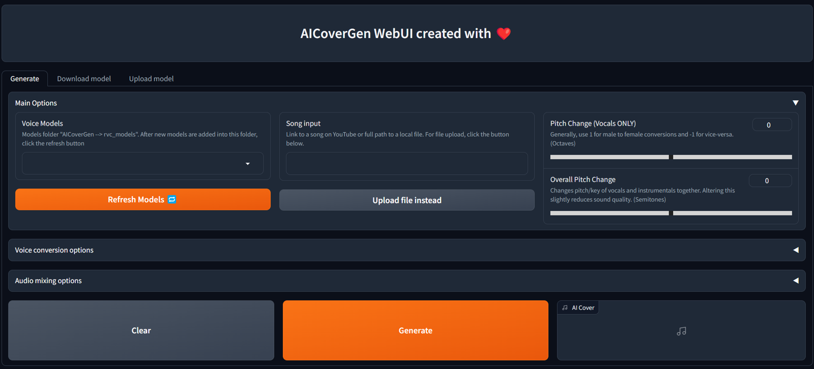
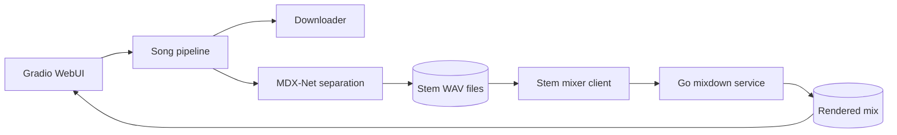

# Stem Split Studio

Separate any song into vocals, drums, bass and other, then re-mix the stems in the browser.



## Why

Practising over a song, or building a karaoke version of it, means pulling the parts apart first. The separation models that do this are good, but they arrive as command line scripts with model files that have to be placed by hand, and the output is a folder of WAV files with no way to hear them together. Anyone who wants to mute the drums for a minute, or push the bass up, ends up in an audio editor for every small change. Stem Split Studio keeps the separation and the mixing in one place, so a song goes in and a mix comes out with the settings that produced it.

## How it works

A song arrives as a local file or a YouTube link. The pipeline converts it to stereo, runs the MDX-Net separation models to split vocals from instrumental and then main vocals from backup vocals, and applies de-reverb to the main vocal. The separated stems are then handed to the mixing desk, where each stem gets a gain, a mute and a solo, and a small Go service sums them, normalises loudness and returns the mixdown.



The mixing desk is the part added on top of the separation pipeline. `src/stem_mixer.py` finds the separated stems in the song folder with `collect_stems`, turns the four rows of the mixing tab into settings with `settings_from_form`, and `MixRequest.validate` rejects a missing stem, a gain outside -60 to 12 dB or a mix where every stem is muted. `MixRequest.audible_stems` decides what plays: if any stem is soloed only the soloed stems are heard, otherwise the unmuted ones. `MixerClient.render` posts the settings to the Go service, starting the binary on demand and waiting on `/healthz` if it is not up yet, then writes the returned WAV next to the stems. In `mixer/main.go`, `readWAV` decodes the 16 and 32 bit stem files, `mixStems` checks that every stem shares the sample rate and channel count, applies `dbToLinear` gain to the audible ones and sums them, and `normalise` scales the sum to the target loudness without pushing the peak past full scale, reporting the change in the `X-Loudness-Change-DB` header. `song_cover_pipeline` in `src/main.py` calls `mix_stems` after the cover is combined and returns the mixdown path beside the cover, so the browser preview and the exported file come from the same summing code.

## Key decisions

- The mixdown runs in a separate Go service rather than in Python, so the summing loop is fast and the same code path serves the preview and the export. The cost is a second process to build and start.
- Stems are kept as WAV files on disk instead of being held in memory, which keeps memory flat for long songs but means a song directory grows quickly unless intermediate files are cleared.
- Separation results are cached per song hash, so a second run with different mix settings skips the models entirely. The cost is that changing a separation model requires clearing the song directory.
- The WebUI is built with Gradio rather than a custom front end, which keeps the whole app in Python but limits how the mixing desk can look.

## Tech stack

- Python 3.9 with Gradio for the interface
- PyTorch and ONNX Runtime for the separation and voice models
- librosa, soundfile, pydub and pedalboard for audio handling
- Go for the mixdown service
- Docker and Cog for packaging

## Quick start

Prerequisites: Python 3.9, Go 1.21 or newer, ffmpeg and sox on the PATH, and a CUDA-capable GPU for the separation models.

```bash
pip install -r requirements.txt
cd mixer && go build -o ../bin/stem-mixer . && cd ..
python src/webui.py --listen --listen-port 7860
```

The Cog image builds the mixer binary as part of the image:

```bash
cog build
```

| Variable | What it sets | Default |
| --- | --- | --- |
| `STEM_MIXER_URL` | Address of the Go mixdown service | `http://127.0.0.1:8099` |

## Usage

```bash
python src/webui.py --listen-port 7860
```

Open the page, paste a song link or upload a file, pick a voice model, then open the Stem mixing tab, set the gains and press Render. The rendered file is written next to the stems:

```text
song_output/9f2c1a7b3d0/
  song_Instrumental.wav
  song_Vocals_Main_DeReverb.wav
  song_Vocals_Backup.wav
  song_mix_g0_m0_s0.wav
```

## Project structure

```text
src/            separation pipeline, WebUI and stem mixer client
mixer/          Go mixdown service and its tests
mdxnet_models/  separation model parameters
rvc_models/     voice models and the public model index
song_output/    one directory per processed song
```

## Limitations

- The mixer works on whole stems only; there is no per-section editing or automation.
- Loudness normalisation targets a fixed level, so very dynamic songs can lose some of their range.
- The separation models need a GPU to be usable on full-length songs.
- Presets are stored as plain files, with no way to share them between machines yet.

## License

MIT. The licence text is in LICENSE.
